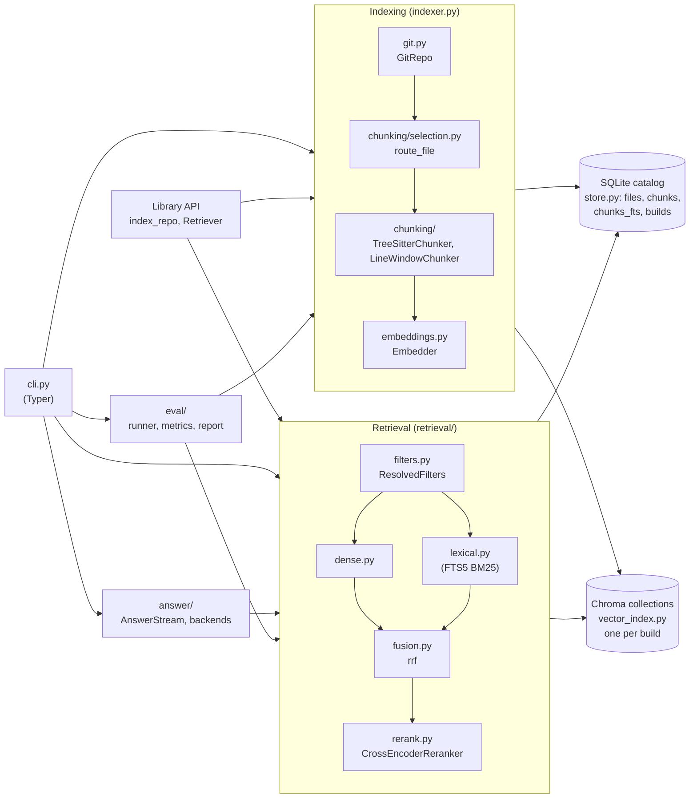
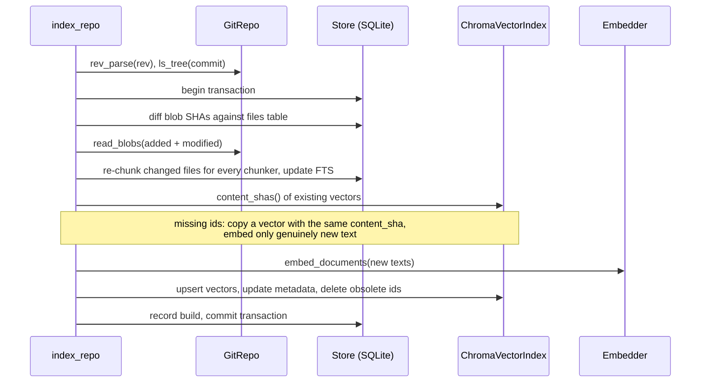
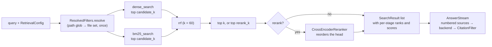

# Architecture

This document describes how `codebase-qa` is built and why. It is written for people changing the code; the [README](../README.md) covers installing and using it.

## Scope

`codebase-qa` indexes one committed revision of a Git repository and answers questions about it:

- **Index**: split files into syntax-aware chunks, embed them, and store them for dense and lexical search.
- **Search**: dense, BM25 or hybrid retrieval with metadata filters and optional cross-encoder reranking.
- **Ask**: send the top results to a language model and stream an answer whose `[n]` citations are checked against the sources it was given.
- **Eval**: measure retrieval quality on hand-written question sets.

Everything runs locally by default. Code leaves the machine only when an answer backend is pointed at a hosted endpoint.

Out of scope: indexing uncommitted changes, multi-repository indexes, a server or web UI, and agentic multi-step retrieval.

## Components

| Module | Responsibility |
|---|---|
| `git.py` | Lists a commit's tree (`git ls-tree`) and streams blob contents through one `git cat-file --batch` process. |
| `chunking/` | File routing (`selection.py`), the language registry (`languages.py` plus `queries/*.scm`), the tree-sitter and line-window chunkers, and the `Chunk` model (`base.py`). |
| `embeddings.py` | The `Embedder` protocol and its backends: `SentenceTransformerEmbedder` (pinned presets), `OllamaEmbedder`, and the test fake `HashEmbedder`. |
| `store.py` | The SQLite catalog: schema, schema-version check, chunk and FTS writes, BM25 queries, build records. |
| `vector_index.py` | `ChromaVectorIndex`, the only module that imports `chromadb`. |
| `indexer.py` | `index_repo`: brings the catalog to a revision and syncs one build's collection to it. |
| `retrieval/` | `Searcher` (one build, dense/BM25/hybrid), `Retriever` with `RetrievalConfig` (adds reranking), filters, fusion, reranker. |
| `answer/` | Prompt layout, the streaming `CitationFilter`, `AnswerBackend` implementations (OpenAI-compatible HTTP, Anthropic). |
| `eval/` | Question sets, metrics, the staged runner and report writers. |
| `cli.py` | The `codebase-qa` command. Model loading and flag/env handling live here, not in the library. |

## Storage model

An index directory (default `<repo>/.codebase-qa/`) holds two stores:

- **`catalog.sqlite3`, the system of record.** It holds:
  - `files`: path, blob SHA, language and size for every indexed file at the current revision;
  - `chunks`: text, location, symbol metadata, file role and `content_sha`, keyed by chunker, so tree-sitter and window chunk sets coexist;
  - `chunks_fts`: an FTS5 table with three columns, `terms` (text plus split identifiers), `path` and `symbol`;
  - `builds`: one row per vector collection, with model, model revision, chunker, dimension and the revision it was indexed at;
  - `meta`: the current revision and the chunk settings.

  `PRAGMA user_version` holds the schema version. A mismatch is refused with a hint to rebuild; there are no migrations before 1.0.
- **`vectors/`, Chroma collections derived from the catalog.** There is one collection per *build*, meaning one (embedding model, model revision, chunker) combination. It is named by `collection_name` from the model slug, the first eight characters of the revision and the chunker. Each collection uses cosine space with unit-length vectors. Its metadata mirrors the catalog: `file_path`, `language`, `symbol_name`, `symbol_kind`, `role`, line range, `commit`, `chunker` and `content_sha`. Missing values are stored as `""`, because Chroma rejects null metadata.

The catalog tracks one current revision. A build indexed at any other revision is **stale**: `stats` shows it, and `search`/`ask` refuse it with the command that refreshes it.

### Chunk identity

- `chunk_id` hashes the file path, symbol path, start line, chunker and text. It changes when any of these change, so a chunk's id identifies exactly one span of one file.
- `content_sha` hashes the *embedded input*: a small header (path, symbol path, kind) followed by the text. Two chunks with the same `content_sha` can share a vector. A renamed file or a moved symbol changes the header, so it is re-embedded, by design.

## Indexing

- **Incremental by construction.** A file whose blob SHA is unchanged is never read, re-chunked or re-embedded. A changed file deletes its old chunks and inserts new ones. Vectors are reused whenever the embedded input is identical, so a one-line edit re-embeds only the chunks it touched.
- **Up-to-date check before model load.** `is_up_to_date` compares revision, build and chunk settings without loading the embedding model, so a no-op `index` returns in about a second.
- **Crash safety by write order.** Vectors are written to Chroma before the SQLite transaction commits. A crash in between leaves vectors the catalog doesn't reference; the next sync deletes or overwrites them. The catalog never references a vector that doesn't exist.
- **Drift repair.** `index --verify` runs the same sync even when the build looks current, reconciling the two stores' id sets.
- **Changing chunk settings** (token budget, excludes) forces every file to be re-chunked.

### File selection

`route_file` decides how each file is handled:

- **Symbol chunking** for Python, TypeScript, TSX, JavaScript and JSX.
- **Line windows** for Markdown, reStructuredText, JSON, YAML, TOML, HTML and CSS, tagged with their language.
- **Skipped:**
  - other extensions;
  - files over 1 MB;
  - lockfiles and minified assets;
  - `dist/`, `build/`, `vendor/` and `node_modules/`;
  - user `--exclude` globs.

`role_for_path` tags each file as `source`, `test`, `docs` or `config`. Roles are a filter, not a ranking weight.

### Chunking

`TreeSitterChunker` gives every line of a file to at most one definition:

- Each line belongs to the innermost class, function or method that isn't itself nested inside a function.
- Classes own their header and fields. Methods own their bodies. Nested functions stay inside their parent.
- Lines no definition owns become `module` chunks.

Each owner's lines are then packed into windows of at most 256 tokens, header included. An oversized symbol is therefore split into overlapping pieces that all keep its symbol metadata, and a single over-long line is split at word boundaries.

The budget is fixed and measured with one reference tokenizer (the default MiniLM model's), so every embedding model sees identical chunks and model comparisons are not confounded by chunking. `LineWindowChunker` packs plain line windows to the same budget. It is the fallback for non-code files and the baseline the eval compares against.

## Query path

- **Filters apply inside every retriever, never after top-k.** Language, symbol kind and role go straight into the Chroma `where` clause and the SQL `WHERE` clause. A path glob is resolved once in SQLite to a file set and passed to Chroma as `file_path $in [...]`, so dense and BM25 search the same candidates. Above `MAX_IN_FILTER` files, the dense side oversamples and post-filters instead.
- **BM25** runs on FTS5 over three weighted columns: symbol 3.0, text 1.0, path 0.5. Identifiers are indexed both whole (`_` is a token character) and split (`getUserById` also gives `get user by id`). As a result, a name query ranks the definition above its callers.
- **Hybrid** fuses the two ranked lists with reciprocal rank fusion. Scores from the two retrievers are on incomparable scales, so only ranks are combined.
- **Reranking** is off by default. When on, a cross-encoder rescores the fused top `rerank_k` (default 20) query-chunk pairs. It costs about a second per 20 pairs on a laptop CPU.
- **Answering** lays the results out as numbered blocks (`[n] path:start-end`), sources first and question last. The answer streams through `CitationFilter`, which drops `[n]` references to sources that weren't provided, even when a citation is split across stream chunks. A valid citation proves the cited span exists and was retrieved. It does not prove the span supports the claim.

## Evaluation

The eval measures retrieval, because an answer can only cite what retrieval returned.

- **Gold targets don't depend on the chunker.** A target is a file, or a `symbol_path` within a file. Spans are resolved by running the tree-sitter chunker on the pinned commit. A name declared more than once, such as a TypeScript interface and a const, keeps separate spans.
- **Duplicates are removed before ranks are counted.** Several retrieved pieces of one function occupy one rank.
- **Two levels are scored:**
  - *File level:* was the right file retrieved?
  - *Symbol level:* was the right definition retrieved? A method hits its class. A window chunk hits every gold symbol whose span it overlaps, at its own rank.
- **Metrics:** recall@k for k = 1, 5, 10, and MRR cut at 10. Results are broken down by question type: identifier, conceptual, cross-file.
- **Staged sweep:**
  - Stage 1: chunker × embedder, dense only.
  - Stage 2: BM25 / hybrid × rerank on the best embedders.
- **Caching:** indexes are cached per corpus, so later stages pay only for queries.

## Extension points

| To add | Implement | Notes |
|---|---|---|
| A language | A `LanguageSpec` with grammar loader, extensions and a `.scm` query capturing `@definition.<kind>` and `@name` | Register it in `builtin_specs`; the chunker needs no changes. |
| An embedding model | The `Embedder` protocol (`model_id`, `revision`, `dimension`, `max_seq_length`, `embed_documents`, `embed_query`) | Return unit-length float32 vectors. A new model or revision gets its own collection automatically. |
| An answer backend | The `AnswerBackend` protocol (`name`, `model`, `stream`) | Raise `BackendUnavailableError` when the endpoint can't be reached. |
| A reranker | The `Reranker` protocol (`score`) | Higher scores rank first. |

## Key decisions

| Decision | Why | Rejected alternative |
|---|---|---|
| SQLite is the system of record; Chroma is a derived index | One transactional place for files, chunks, builds and BM25; vectors can be rebuilt from it | Everything in Chroma: BM25 would be rebuilt in memory, and bookkeeping duplicated per model |
| BM25 through SQLite FTS5 | Incremental, on disk, already a dependency | Chroma's native hybrid search (cloud only); `rank-bm25` (in memory, not incremental); a separate search engine |
| Index a committed revision | The blob SHA is the content hash, and the recorded commit is exact | Hashing the working tree: dirty files make citations point at code no commit contains |
| Shell out to the `git` CLI | Small, fast, no native dependency | GitPython (slow subprocess wrapper); pygit2 (libgit2 binary dependency) |
| Compute embeddings ourselves and pass vectors to Chroma | The catalog always knows which model produced a collection | Chroma embedding functions, which hide model ownership and risk a query/document model mismatch |
| One collection per (model, revision, chunker), cosine space | Re-pinning a model never mixes weight versions; cosine distances are readable | One shared collection; the default squared-L2 space |
| Reuse vectors by `content_sha` | Small edits to large files re-embed only what changed | Re-embedding whole files; purely content-addressed ids, where identical snippets in two files collide |
| Split oversized symbols into budgeted windows that keep their metadata | Embeddings stay focused, and `ask` context stays small | Embedding whole symbols (blurred vectors, truncation); a budget per model, where chunk sets differ and confound comparisons |
| Code-aware FTS tokenization with a weighted symbol column | Definitions outrank callers on name queries | The default tokenizer on raw text, which misses camelCase sub-terms and ranks by mention count |
| Filters resolved once and applied inside each retriever | Both retrievers see an identical candidate set | Post-filtering top-k, which silently returns fewer than k |
| Reciprocal rank fusion with fixed k = 60 | Needs no score calibration | Weighted score sums, which need tuning per corpus |
| Cross-encoder reranking, off by default | Large precision gains on prose queries, at an explicit CPU cost | Always on (slow); a hosted reranker (sends code off-machine) |
| OpenAI-compatible HTTP as the default answer backend, local Ollama as the default endpoint | One small client covers Ollama, llama.cpp and hosted providers; the default never sends code to a paid host | The `openai` SDK (a dependency for one endpoint); a single paid provider |
| Validate `[n]` citations while streaming | A bad citation is removed before the user sees it | Trusting model citations; validating after streaming |
| Tests never download models | Fast, deterministic CI on any machine | Real models in unit tests |
| CPU PyTorch wheels on Linux | About 1 GB install instead of several GB of CUDA wheels | Default CUDA wheels |
| No config file; flags, then env, then index-recorded build, then default | Fewer places for settings to hide; `search` defaults to how the index was built | A config file, which is one more source to reconcile |
| Hand-written eval questions, written from the source before any retrieval run | The questions measure retrieval, not the author's knowledge of the index | Generating questions from chunks, which echoes chunk wording and flatters BM25 |

## Limitations

- Only committed revisions are indexed; uncommitted changes are invisible.
- One current revision per index directory. Comparing two revisions needs two index directories.
- Code-tuned embedding models are slow on CPU (CodeRankEmbed runs at roughly 1 chunk/s on a laptop CPU), so the default is the small general-purpose MiniLM.
- Very broad path globs (more than `MAX_IN_FILTER` files) make dense search post-filter an oversampled list, which can return fewer than k results.
- Citations are checked for existence, not for support.
- The tree-sitter runtime is pinned below 0.26, which crashes under repeated query matching.
